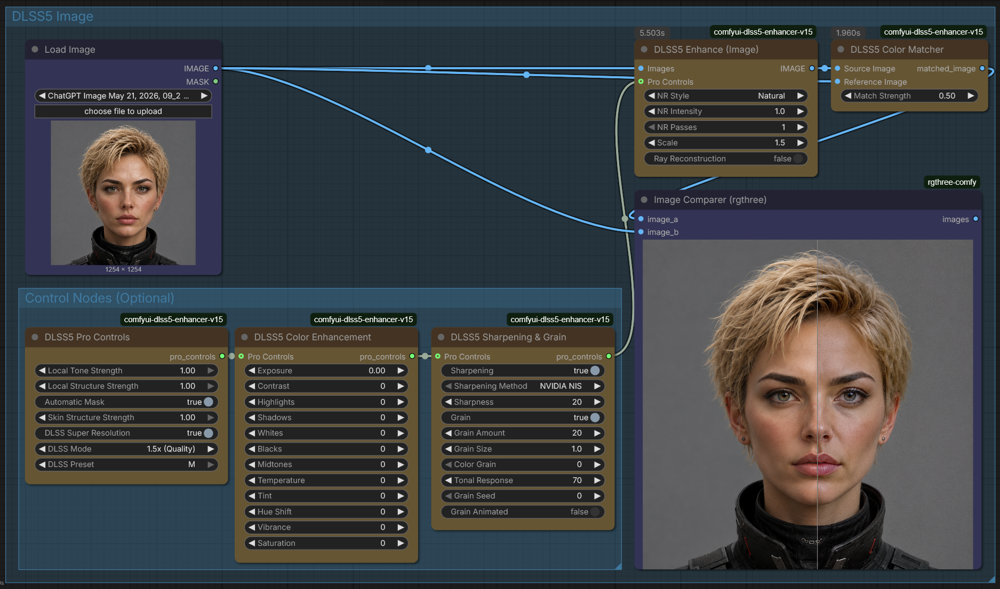
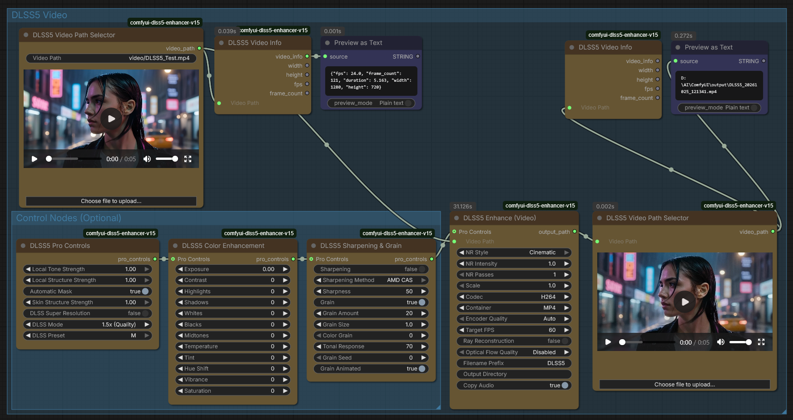

# ComfyUI-DLSS5-Enhancer


> ⚠️ **IMPORTANT UPGRADE NOTICE FOR EXISTING USERS (v1.3.0)**  
> This update introduces a **modular control chain** and renames several widgets for clarity. 
> - If you are upgrading from v1.1.x or earlier, **your existing workflows will need to be rebuilt**. 
> - The old monolithic controls have been split into dedicated nodes: `DLSS5 Pro Controls`, `DLSS5 Color Enhancement`, and `DLSS5 Sharpening & Grain`.
> - Widget names have changed (e.g., `video_path` is now `Video Path`).
> - Please review the "🔗 Recommended Control Chain" section below to rebuild your graphs.


Run NVIDIA DLSS 5 Neural Rendering over your frames and videos, directly inside ComfyUI.

DLSS 5 is NVIDIA's neural rendering pass. In a game, it reconstructs the material and lighting detail that real-time rendering has to leave out, such as skin subsurface scattering, light transmission through hair, and contact shadows. This node pack drives that same native renderer over video frames and image batches, with optional 1x to 16x RTX upscaling, DLSS Ray Reconstruction, and DLSS Frame Generation.

It is not a filter that imitates a look. Frames go to the native renderer and come back reconstructed. The model reconstructs materials and recovers structure (skin, hair, fabric) that the source only implied, rather than just sharpening edges.

Unlike older community implementations that relied on ReShade injection, this pack drives the official v17.5 headless CLI (`VE_CLI.exe`), providing a stable, native, and highly optimized pipeline.

**Acknowledgment:** This node pack acts as a bridge to the excellent [DLSS 5 Visual Enhancer](https://github.com/Merserk/dlss5-visual-enhancer) project by Merserk. All underlying AI rendering, upscaling, and frame generation capabilities are powered by their work and the official NVIDIA runtime. This project simply makes that powerful technology accessible directly within ComfyUI workflows.

---

## 🚀 What's New in v1.3.0

This update introduces a full **modular control chain**, a **post-process color matching node**, and major quality-of-life fixes for video workflows.

### New & Reworked Nodes
* **DLSS5 Pro Controls** — Advanced native render controls (local tone/structure, auto mask, skin detail, DLSS Super Resolution mode/preset). Outputs a `pro_controls` preset string.
* **DLSS5 Color Enhancement** — Full Light & Color grading panel (Exposure, Contrast, Highlights, Shadows, Whites, Blacks, Midtones, Temperature, Tint, Hue Shift, Vibrance, Saturation) written into the preset's coloring stage.
* **DLSS5 Sharpening & Grain** — Toggleable sharpening (NVIDIA NIS / AMD CAS) and film grain (amount, size, color, tonal response, seed, animation).
* **DLSS5 Color Matcher** — A pure image-processing node placed *after* the Enhance node. Uses Reinhard color transfer (Lab space) to cancel neural-render color drift so the final output matches your reference image's colors.

### Pipeline & UX Improvements
* **Control Chain Architecture:** All grading nodes connect via a single `pro_controls` STRING socket: `Pro Controls → Color Enhancement → Sharpening & Grain → Enhance (Image/Video)`.
* **Neural controls moved:** `NR Style`, `NR Intensity`, and `NR Passes` now live directly on the Enhance nodes for per-render control.
* **Friendly widget labels** across all nodes (e.g., `NR Style`, `Encoder Quality`, `Video Path`).
* **Smart Upload Deduplication:** The Video Path Selector's upload button now hashes file content (SHA-1). If the video already exists anywhere in `ComfyUI/input` (including subfolders), it reuses the existing file instead of creating `_1`, `_2` copies.
* **Preset Schema Normalization:** Presets are automatically normalized to the CLI-supported schema version, so app-exported presets (schema 41) and node-generated presets (schema 38) both work.
* **Cleaner outputs:** Enhance (Video) outputs only `output_path`; the Video Path Selector outputs only `video_path` (metadata moved to the dedicated Video Info node).

### Component Versions
| Component | Version |
|-----------|---------|
| NVIDIA NGX Core | `310.9.16.0` |
| Release Date | October 2026 |

---

## 🧠 How It Works

This pack acts as a bridge between ComfyUI and the native DLSS 5 Visual Enhancer CLI.

1. **Preset Chain:** The control nodes (Pro Controls, Color Enhancement, Sharpening & Grain) build and pass along a JSON preset string (`pro_controls`). Each node injects its settings and enables the required pipeline stages (`neural_model`, `coloring`, `cas_sharpening`, `grain`, `dlss_super_resolution`, etc.).
2. **Neural Rendering & Ray Reconstruction:** The Enhance node exports your frames (or passes your video path) to `VE_CLI.exe` with the preset via `--preset`. The CLI hosts the native NVIDIA runtime to reconstruct high-frequency material details. With Ray Reconstruction enabled, the dedicated `reconstruct` command runs at native resolution (1x) with high-precision color handling.
3. **RTX Upscaling:** Reconstructed frames optionally pass through NVIDIA's RTX Super Resolution engine (up to 16x).
4. **DLSS Frame Generation:** Optionally interpolates video to a target FPS (RTX 40/50 only).
5. **Color Match (Post):** The Color Matcher node compares the enhanced output against a reference image and applies a Reinhard color transfer to cancel any color drift introduced by the neural pass.

---

##  Requirements

| Item | Requirement |
|------|-------------|
| GPU | NVIDIA RTX 20, 30, 40, or 50 Series. (GTX, AMD, and Intel GPUs are not supported). |
| GPU (Frame Gen) | DLSS Frame Generation requires RTX 40 or 50 Series + Hardware-accelerated GPU scheduling. |
| Driver | Recent NVIDIA Game Ready or Studio Driver (560.xx+). |
| OS | Windows only. |
| ComfyUI | Recent build supporting standard `IMAGE` tensor types. |
| Python | `imageio-ffmpeg`, `scikit-image` (installed via `requirements.txt`). |

---

## ️ Installation

**Step 1: Install the Node Pack**

Clone this repository into your `ComfyUI/custom_nodes/` folder:

```bash
git clone https://github.com/Strix-3D/ComfyUI-DLSS5-Enhancer-v15.git
```

Then install dependencies from your main ComfyUI folder:

```bash
.\python_embeded\python.exe -m pip install -r ComfyUI\custom_nodes\ComfyUI-DLSS5-Enhancer-v15\requirements.txt
```

**Step 2: Download the Runtime & Accept the License**

```bash
.\python_embeded\python.exe ComfyUI\custom_nodes\ComfyUI-DLSS5-Enhancer-v15\install.py
```

Wait for the ~700MB runtime to download into `runtime/`.

**Step 3: Restart ComfyUI.** Nodes appear under the `DLSS5_v17` category.

---

##  Nodes & Parameters

### 1. DLSS5 Enhance (Image)
Applies Neural Rendering (or Ray Reconstruction) and optional RTX upscaling to an image batch.

| Widget | Options / Range | Default | Effect |
|--------|-----------------|---------|--------|
| Images | IMAGE | — | Input image or batch. |
| NR Style | Default / Natural / Cinematic | Default | The AI's reconstruction "personality". Natural is best for faces; Cinematic adds punch but can crush shadows. |
| NR Intensity | 0.0 – 2.0 | 1.0 | Strength of the neural effect. >1.5 risks AI hallucinations. |
| NR Passes | 1 – 4 | 1 | Neural render passes. More passes = more reconstructed micro-detail. |
| Scale | 1.0 – 16.0 | 2.0 | RTX upscaling multiplier. 1.0 skips upscaling. |
| Ray Reconstruction | BOOLEAN | False | Native 1x reconstruction with high-precision color. For 3D/RTX captures. |
| Pro Controls *(optional socket)* | STRING | — | Input from the control chain. |

**Output:** `IMAGE`

### 2. DLSS5 Enhance (Video)
Processes a video file natively in a single CLI pass (temporally stable), with optional upscale, interpolation, and audio muxing.

| Widget | Options / Range | Default | Effect |
|--------|-----------------|---------|--------|
| Video Path | STRING (linkable) | — | Relative path in `input/`, or linked from Selector/other nodes. |
| NR Style / NR Intensity / NR Passes | as above | Default / 1.0 / 1 | Neural render personality, strength, passes. |
| Scale | 1.0 – 16.0 | 1.0 | RTX upscale multiplier. |
| Codec | HEVC / H264 / AV1 / ProRes Proxy | H264 | Hardware encoder. H264 caps at 4096px wide. |
| Container | MKV / MP4 / MOV | MP4 | Output container. |
| Encoder Quality | Auto / Good / Best / Max | Auto | Encoding bitrate/quality. |
| Target FPS | 0 – 120 | 0 | 0 = disabled. DLSS Frame Generation target (RTX 40/50). |
| Ray Reconstruction | BOOLEAN | False | Mutually exclusive with DLSS Super Resolution. |
| Optical Flow Quality | Disabled / High / Medium / Low | Disabled | Temporal stability for Ray Reconstruction. |
| Filename Prefix | STRING | DLSS5 | Output filename prefix (timestamp appended). |
| Output Directory | STRING | — | Relative subfolder inside `output/`. |
| Copy Audio | BOOLEAN | True | Mux original audio into the output. |
| Pro Controls *(optional socket)* | STRING | — | Input from the control chain. |

**Output:** `output_path` (STRING)

### 3. DLSS5 Video Path Selector
Browse, upload, and chain video paths without typing. Includes a live video preview and an upload button with **content deduplication** (re-selecting an existing video reuses the file in `input/` — no duplicate copies).

| Widget / Output | Type | Effect |
|-----------------|------|--------|
| Video Path | STRING (linkable) | Type a relative path, upload, or accept a link. |
| Choose file to upload... | Button | Uploads into `input/`; reuses identical existing files by SHA-1 hash. |
| Live preview | Preview | Updates on upload, on typing, and on execution. |
| **Output:** `video_path` | STRING | The resolved relative path. |

### 4. DLSS5 Video Info
Lightweight metadata probe for chaining. Plug in any path (e.g., an Enhance node's `output_path`).

**Outputs:** `video_info` (JSON), `width`, `height`, `fps`, `frame_count`.

### 5. DLSS5 Pro Controls
Advanced native render controls. Starts the `pro_controls` chain.

| Widget | Range / Options | Default | Effect |
|--------|-----------------|---------|--------|
| Local Tone Strength | 0.0 – 1.0 | 1.0 | Local tone intensity. |
| Local Structure Strength | 0.0 – 1.0 | 1.0 | Local structure intensity. |
| Automatic Mask | BOOLEAN | True | Targets skin enhancement to detected skin regions. |
| Skin Structure Strength | 0.0 – 1.0 | 1.0 | Skin detail (active when Automatic Mask is ON). |
| DLSS Super Resolution | BOOLEAN | False | Enables the in-render DLSS SR stage. Keep Enhance Scale at 1.0 when using it. |
| DLSS Mode | 1x (DLAA) / 1.5x / 1.724x / 2x / 3x | 1x (DLAA / native) | DLSS render scale (only when SR is ON). |
| DLSS Preset | Default / J / K / L / M | M | DLSS model preset (only when SR is ON). |

**Output:** `pro_controls` (STRING)

### 6. DLSS5 Color Enhancement
Full Light & Color grading panel. Injects `lut_*` values and enables the `coloring` stage.

| Widget | Range | Default | Widget | Range | Default |
|--------|-------|---------|--------|-------|---------|
| Exposure | -3.0 – +3.0 | 0.0 | Temperature | -100 – 100 | 0 |
| Contrast | -100 – 100 | 0 | Tint | -100 – 100 | 0 |
| Highlights | -100 – 100 | 0 | Hue Shift | -180 – 180 | 0 |
| Shadows | -100 – 100 | 0 | Vibrance | -100 – 100 | 0 |
| Whites | -100 – 100 | 0 | Saturation | -100 – 100 | 0 |
| Blacks | -100 – 100 | 0 | | | |
| Midtones | -100 – 100 | 0 | | | |

**Input:** `Pro Controls` (optional) • **Output:** `pro_controls` (STRING)

### 7. DLSS5 Sharpening & Grain
Toggleable sharpening and film grain. Toggles add/remove the `cas_sharpening` and `grain` pipeline stages.

| Widget | Range / Options | Default | Effect |
|--------|-----------------|---------|--------|
| Sharpening | BOOLEAN | True | Enable the sharpening stage. |
| Sharpening Method | NVIDIA NIS / AMD CAS | NVIDIA NIS | NIS recovers edges from soft sources; CAS boosts micro-contrast. |
| Sharpness | 0 – 100 | 50 | Sharpening intensity. |
| Grain | BOOLEAN | True | Enable the grain stage. |
| Grain Amount | 0 – 100 | 20 | Grain intensity. |
| Grain Size | 0.1 – 5.0 | 1.0 | Grain particle size. |
| Color Grain | 0 – 100 | 0 | Monochrome (0) to full-color grain. |
| Tonal Response | 0 – 100 | 70 | How grain reacts to luminance. |
| Grain Seed | 0 – 999999 | 0 | Random seed for reproducibility. |
| Grain Animated | BOOLEAN | True | Animates grain over time (video). |

**Input:** `Pro Controls` (optional) • **Output:** `pro_controls` (STRING)

### 8. DLSS5 Color Matcher
**Place AFTER the Enhance node.** Cancels neural-render color drift so the final output matches your reference's colors. Pure image processing (Reinhard transfer in Lab space via `scikit-image`) — no CLI/LUT involved. Resolution-independent (statistics-based), so the reference can be any size. When Source and Reference are the same image, the result is an exact identity (no change).

| Widget | Type | Effect |
|--------|------|--------|
| Source Image | IMAGE | The enhanced/drifted image (Enhance node output). |
| Reference Image | IMAGE | The colors you want (usually the original input). |
| Match Strength | 0.0 – 1.0 | Blend between uncorrected (0) and fully matched (1). |

**Output:** `matched_image` (IMAGE)

---

## 🔗 Recommended Control Chain

```text
DLSS5 Pro Controls ➔ DLSS5 Color Enhancement ➔ DLSS5 Sharpening & Grain ➔ Enhance (Image/Video)
                                                                                        │
Load Image ➔ Enhance (Images)                    Enhance (IMAGE out) ➔ Color Matcher (Source)
Load Image ─────────────────────────────────────────────────────────➔ Color Matcher (Reference)
```

* The chain is optional — the Enhance nodes work standalone.
* Muted nodes are skipped entirely; a muted control node contributes nothing (its settings are silently ignored).

---

## ⚙️ CLI Flag Mapping (Advanced)

| ComfyUI Widget | CLI Command / Flag |
|----------------|-------------------|
| NR Style | `--style 0` / `1` / `2` |
| NR Intensity | `--strength [0.0–2.0]` |
| NR Passes | preset key `nr_passes` |
| Ray Reconstruction | uses `reconstruct` command instead of `render` |
| Optical Flow Quality | `--flow-quality high/medium/low` |
| Scale | `--scale [1.0–16.0]` |
| Target FPS | `interpolate` command with `--fps` |
| Codec / Container / Encoder Quality | `--codec` / `--container` / `--quality` |
| Control chain settings | `--preset` (JSON, schema auto-normalized to 38) |

---

## 📋 Hardware Capability Cheat Sheet

| GPU Series | Neural Rendering | RTX Upscaling (16x) | DLSS Frame Generation |
|------------|------------------|---------------------|----------------------|
| RTX 50 Series | ✅ | ✅ | ✅ |
| RTX 40 Series | ✅ | ✅ | ✅ |
| RTX 30 Series | ✅ | ✅ | ❌ |
| RTX 20 Series | ✅ | ✅ | ❌ |
| GTX / AMD / Intel | ❌ | ❌ |  |

---

## ✅ Recommended Settings

| Goal | Settings |
|------|----------|
| Clean up generated video, same resolution | Scale 1.0, NR Style Default, NR Intensity 1.0 |
| Clean up and upscale | Same, with Scale 2.0+ |
| Smooth 30fps → 60fps | Target FPS 60 (RTX 40/50 only) |
| Most realistic faces | NR Style Natural, NR Intensity 0.8, Pro Controls Auto Mask ON |
| Maximum detail reconstruction | NR Passes 3–4 (watch for hallucinations) |
| High-precision 3D/RTX cleanup | Ray Reconstruction ON, NR Style Default |
| More contrast/punch | NR Style Cinematic (check shadows) |
| Cancel AI color drift | Color Matcher after Enhance; Reference = original input |
| Output too strong/plastic | Drop NR Intensity to 0.6–0.7 or switch to Natural |

---

## 🧪 Example Workflows

**Image Enhancement + Color Match**


```text
Load Image ➔ Pro Controls ➔ Color Enhancement ➔ Sharpening & Grain ➔ Enhance (Image)
                                                                              │
Load Image ➔ Enhance (Images)                                                 │
Load Image ➔ Color Matcher (Reference)          Enhance out ➔ Color Matcher (Source) ➔ Save/Compare
```

**Video File Enhancement**


```text
Video Path Selector ➔ Enhance (Video) ➔ output_path ➔ Video Info / Load Video (Path) ➔ Video Combine
```

---

## 🔧 Troubleshooting

| Message / Issue | Cause and Fix |
|-----------------|---------------|
| `Unsupported preset schema version` | Fixed in v1.3.0 — presets are normalized to schema 38 automatically. If it reappears, update the pack. |
| Upload creates duplicate copies | Fixed in v1.3.0 — uploads are deduplicated by SHA-1 content hash; existing files in `input/` are reused. |
| Control settings seem ignored | Check the node isn't **muted** (faded). Muted nodes are skipped and contribute nothing. |
| Color Matcher output = source | Expected when Source and Reference are the same image (identity transfer). |
| `ModuleNotFoundError: skimage` | Run `pip install -r requirements.txt` in your ComfyUI environment. |
| SmartScreen blocks `VE_CLI.exe` | Right-click the .exe → Properties → Unblock. |
| Width N exceeds 4096 | H264 encoder cap. Switch Codec to HEVC/AV1 or lower Scale. |
| Frame Generation fails on RTX 20/30 | Requires RTX 40/50. Set Target FPS to 0. |
| Video preview stale on linked path | Preview refreshes on execution; hard-refresh browser (Ctrl+F5) if needed. |
| Output looks "plastic" | NR Intensity too high. Drop to 0.7–1.0 or use Natural style. |

---

## 📁 Project Layout

```text
ComfyUI-DLSS5-Enhancer-v15/
   install.py             Downloads the runtime and prompts for license acceptance
   nodes.py               ComfyUI node definitions (8 nodes)
   paths.py               Runtime discovery and validation
   __init__.py            ComfyUI extension entrypoint (serves web/)
   README.md              This file
   LICENSE                MIT License (Python source)
   requirements.txt       Python dependencies (imageio-ffmpeg, scikit-image)
   images/                Workflow screenshots for documentation
   web/dlss5_selector.js  Frontend extension (upload button + live preview)
   runtime/               Native runtime (VE_CLI.exe, NVIDIA DLLs) - *Not tracked*
   config.json            Local path configuration - *Not tracked*
```

---

## ️ Licensing and Attribution

The Python source code in this repository is licensed under the MIT License.

This repository does not host or redistribute the AI runtime binaries. The `install.py` script downloads the official DLSS 5 Visual Enhancer v17.5 release from [Merserk/dlss5-visual-enhancer](https://github.com/Merserk/dlss5-visual-enhancer). The downloaded runtime contains proprietary components owned by their respective creators:

* **NVIDIA Corporation:** DLSS Super Resolution, Neural Rendering (v310.9.16.0), Frame Generation, Ray Reconstruction, Optical Flow, and RTX Video SDKs (Proprietary).
* **Merserk:** Visual Enhancer CLI and Engine (Merserk Source License).
* **FFmpeg/mpv:** Media processing binaries (GPLv2/v3).

By installing this node pack, you agree to use these components only under the terms permitted by their respective licenses. This project is not affiliated with or endorsed by NVIDIA or the Merserk project.